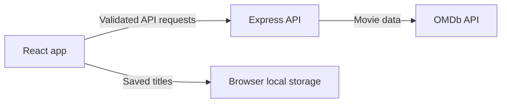

# usePopcorn

**Find a movie or series, explore the details, rate what you watch, and keep your own collection.**

[](https://github.com/Abdullah-Mohammed456/usePopcorn/actions/workflows/ci.yml)
[](LICENSE)
[](tsconfig.json)
[](#deployment)

**Live demo:** (https://usepoopcorn.vercel.app)

<!-- Screenshots: add current captures under docs/screenshots after deploying. -->

| Discover                                                   | My list                                                      |
| ---------------------------------------------------------- | ------------------------------------------------------------ |
| _Screenshot placeholder — capture the Discover page here._ | _Screenshot placeholder — capture the collection page here._ |

## Features

- Search movies and series through the OMDb API, with paginated results (10 titles per page).
- Open a title to see its plot, cast, director, rating, and series episodes.
- Give a title a personal rating and save it to the local collection.
- Review collection statistics and remove saved titles.
- Browse results in responsive poster rails with keyboard-accessible details.
- Keep the collection in browser local storage; no account or database is required.
- Keep the OMDb key on the API server, outside the browser bundle.

## Tech stack

- React 19, TypeScript in strict mode, and Vite 8
- Express 5, Helmet, CORS, express-rate-limit, and Zod
- OMDb API for movie and series data
- GSAP with ScrollTrigger, dynamically imported for optional scroll motion
- Anton for display headings; system fonts for body text

The interface follows a dark, streaming-catalog direction with a red accent and movie poster shelves. Motion is removed when `prefers-reduced-motion` is enabled. Three.js is not included because a 3D scene does not support this app’s search and collection tasks.

## Architecture



The browser calls the Express API for OMDb data. The API validates request parameters, adds the server-side API key, and returns provider responses. The collection is stored locally in the browser. The project has no database.

## Getting started

### Prerequisites

- Node.js 24 or Node.js 22.13 and later in the 22.x line
- npm
- An OMDb API key for movie and series search

### Install and run

```bash
npm install
cp .env.example .env
```

Put your OMDb key in your local `.env` as `OMDB_API_KEY`. The key must not use a `VITE_` prefix. For the deployed site, set the key once in Render; visitors do not need to create or provide their own key. Then start both the web app and API:

```bash
npm run dev
```

Vite serves the app at `http://localhost:5173`; the Express API listens on `http://localhost:3000` and is reached through the Vite proxy.

### Environment variables

| Variable            | Required                              | Used by  | Description                                                    |
| ------------------- | ------------------------------------- | -------- | -------------------------------------------------------------- |
| `OMDB_API_KEY`      | Yes                                   | Express  | Server-only credential for OMDb requests                       |
| `CORS_ORIGINS`      | Yes in production                     | Express  | Comma-separated list of exact allowed frontend origins         |
| `VITE_API_BASE_URL` | Production                            | Vite app | Render API origin, with no trailing slash; leave blank locally |
| `VITE_SITE_URL`     | Yes for canonical and Open Graph URLs | Vite app | Public site origin, such as `https://your-site.vercel.app`     |

`.env.example` contains placeholders only. Do not commit `.env` or put server secrets in `VITE_*` variables.

For production, the Express server on Render uses your single `OMDB_API_KEY` for all visitors. Add it in the Render service's **Environment** settings. Do not add `OMDB_API_KEY` to Vercel: the browser calls Render, and the key stays on the server. All visitors share the request quota of that OMDb key.

### Commands

| Command             | Purpose                                         |
| ------------------- | ----------------------------------------------- |
| `npm run dev`       | Start Vite and the Express API together         |
| `npm run lint`      | Run ESLint                                      |
| `npm run typecheck` | Type-check the frontend and API                 |
| `npm run format`    | Format supported repository files with Prettier |
| `npm run build`     | Type-check and build the frontend and API       |
| `npm start`         | Start the compiled Express API                  |

There is no automated test suite configured yet.

## Deployment

The frontend deploys to Vercel and the Express API deploys to Render. Configure the backend first, then point the frontend at it.

### Render API

1. Create a Render web service from this repository or use the included Blueprint file [`render.yaml`](render.yaml).
2. Use `npm install --include=dev && npm run build:server` as the build command and `npm start` as the start command.
3. Set `OMDB_API_KEY` to your OMDb key and `CORS_ORIGINS` to the exact Vercel site origin. Keep `sync: false` values in the Render dashboard.
4. Confirm the health check at `/health` returns `{ "status": "ok" }`.

Render supplies `PORT`; the API binds to `process.env.PORT`.

### Troubleshooting the movie API

`/health` checks that Express is running; it does not check the OMDb key or upstream connection. Test `/api/movies?query=batman&page=1` to check the provider. Failures include a safe `code` in the JSON response and an `[omdb] request failed` entry in Render logs. Logs never include the key, request URL, or raw provider body.

| Code                                        | Action                                                                                                                                  |
| ------------------------------------------- | --------------------------------------------------------------------------------------------------------------------------------------- |
| `OMDB_NOT_CONFIGURED`                       | Set `OMDB_API_KEY` in Render and redeploy.                                                                                              |
| `OMDB_AUTHENTICATION_FAILED`                | Confirm the value is the OMDb key alone, with no URL or surrounding quotes, and follow the activation link in the OMDb email if needed. |
| `OMDB_QUOTA_EXCEEDED`                       | Wait for the provider quota to reset or change the OMDb plan.                                                                           |
| `OMDB_TIMEOUT`                              | Retry; the provider did not respond within the timeout.                                                                                 |
| `OMDB_CONNECTION_FAILED`                    | Investigate outbound connectivity from Render to OMDb.                                                                                  |
| `OMDB_HTTP_ERROR` / `OMDB_INVALID_RESPONSE` | Check the upstream HTTP status in Render logs and provider availability.                                                                |

If the API returns `OMDB_INVALID_KEY_FORMAT`, `OMDB_API_KEY` contains a request URL instead of the key. Set only the key value in Render.

### Vercel frontend

1. Import the GitHub repository into Vercel and choose the Vite framework preset.
2. Set the build command to `npm run build`, install command to `npm install --include=dev --no-audit --no-fund`, and output directory to `dist` (also set in [`vercel.json`](vercel.json)).
3. Add `VITE_API_BASE_URL` with the Render service origin and `VITE_SITE_URL` with the public Vercel origin.
4. Add the final Vercel origin to Render’s `CORS_ORIGINS` and redeploy the API.

### Deployment values

| Service | Variable            | Value                                                                     |
| ------- | ------------------- | ------------------------------------------------------------------------- |
| Vercel  | `VITE_API_BASE_URL` | Render API URL, for example `https://usepopcorn-api.onrender.com`         |
| Vercel  | `VITE_SITE_URL`     | Public Vercel site URL                                                    |
| Render  | `OMDB_API_KEY`      | Your OMDb key, set privately in the dashboard                             |
| Render  | `CORS_ORIGINS`      | Comma-separated Vercel production and preview origins you intend to allow |

No Neon database or migrations are needed. The list is kept in browser local storage.

## Project structure

```text
src/
  api/                 Browser API adapter
  components/          Navigation, movie, rating, and collection UI
  hooks/               Search and local-storage state
  types/               OMDb and collection types
  App.tsx              Application state and page composition
  index.css            Responsive visual system
server/
  app.ts                Validated, rate-limited Express API
  index.ts              Production server entry point
design-previews/        Isolated design direction previews
public/                 Favicon and social preview artwork
```

## Roadmap

- Add automated tests for search validation, ratings, and collection persistence.
- Add optional import/export for the local collection.
- Capture current desktop and mobile screenshots for this README.

## Contributing

See [CONTRIBUTING.md](CONTRIBUTING.md) for setup and change guidelines. Before opening a pull request, run `npm run lint`, `npm run typecheck`, and `npm run build`.

## License

Released under the [MIT License](LICENSE).

## Contact

Maintainer: [Abdullah Mohammed](https://github.com/Abdullah-Mohammed456)
